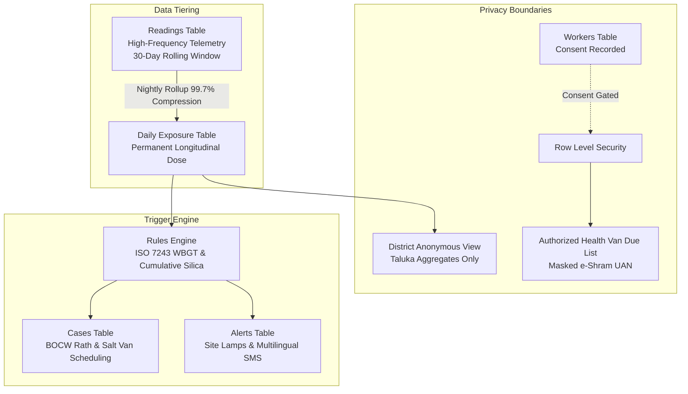

# 🛡️ Dust-Dataset-SSIP: Exposure-Triggered Worker Health Screening
### SSIP Problem Statement: PS000109 | District Administration, DDO Kachchh, Gujarat

[](https://www.python.org/)
[](LICENSE)
[](https://www.iso.org/)
[](https://www.meity.gov.in/)
[](https://abdm.gov.in/)

---

## 📌 Executive Summary

In Kachchh district, Gujarat, over 100,000 informal laborers endure extreme environmental hazards:
- **Coastal Salt Pans (Mundra, Kandla, Little Rann)**: Summer ambient temperatures cross 45°C with 75%+ relative humidity (driving outdoor WBGT above 33°C), intense solar ultraviolet glare off white crystalline salt beds, and prolonged contact with hyper-saline brine causing skin ulcerations.
- **Stone Crushers & Quarries (Bhuj, Anjar)**: Severe respirable crystalline silica concentrations exceeding statutory action levels (25 µg/m³), placing drillers and operators at acute risk of incurable silicosis.
- **Cement & Port Terminals**: Heavy alkaline particulate matter and whole-body vibration.

Traditional workplace safety models rely on expensive personal wearables (such as Kenzen arm patches at ~$50/worker/month) that are economically impossible for informal Indian workforces. 

**Our Solution (PS000109)** introduces an **exposure-triggered, microclimate-linked occupational health system**:
1. **Low-Cost Ambient Nodes (~₹2,015)**: Installed at worksites with a **150 mm standard matte-black copper globe** (ISO 7243 compliant) and laser optical PM sensors with coastal humidity correction.
2. **Automated Multi-Hazard Rules Engine**: Computes live outdoor WBGT, enforces mandatory work-rest cycles (visual RGB lamp indicators), and tallies 30-day cumulative respirable silica doses.
3. **Existing Government Delivery Channels**: Instead of building redundant clinics, our platform prioritizes workers for Gujarat's existing mobile healthcare fleet: the **Gujarat BOCW Dhanvantari Arogya Rath**, the **Industries Commissionerate Salt-Worker Medical Van**, and **ESIC Dispensaries**.
4. **Economic Reality**: Reduces monitoring cost to **< ₹40 per worker per year** while creating portable, worker-owned digital records via **e-Shram UAN** and **ABHA (ABDM)**.

---

## 👥 4-Role Team Architecture & Subsystem Division

| Member | Subsystem | Core Deliverables & Status in Repo |
|---|---|---|
| **You (Agent)** | **Database (Data Layer) & Rules Engine** | ✅ 10 Production Tables, 30-day raw vs. permanent aggregate retention policy, DPDP Act 2023 privacy views, ISO 7243 WBGT engine, PMS5003 humidity correction, 3 query contracts. |
| **Person 2** | **Wokwi Simulation, Device Firmware & Cost Model** | ✅ ESP32 circuit design specs, 150mm copper globe specs, PMS5003 & BME280 wiring, offline flash buffer, complete BOM & price model (< ₹40/worker/yr). |
| **Person 3** | **Government Connections, Public API & Alerts** | ✅ 12-digit e-Shram UAN QR flow, ABHA sandbox architecture, BOCW Dhanvantari Rath & Salt Van CSV export contracts, multilingual alerts (Gujarati & Hindi). |
| **Person 4** | **Pitch Deck, Synopsis PPT & Legal Evidence** | ✅ Slide-by-slide synopsis deck structure, statutory backing (Factories Act 41C, OSH Code 2020, Gujarat OHS Rules 2025), and comparative epidemiological benchmarks. |

---

## 🗄️ Database Architecture (The 10 Core Tables)

The database is implemented in ANSI SQL (`database/schema.sql`) and verified under PostgreSQL 15+ and SQLite 3:



### The 10 Tables:
1. `sites`: Physical worksites (lat/long, taluka, drinking water, toilets, shade flags).
2. `workers`: Worker identity, 12-digit e-Shram UAN, ABHA ID, QR card hash, consent records.
3. `devices`: Hardware inventory (Site Nodes and Personal Dust Badges).
4. `readings`: High-frequency sensor telemetry (Ta, RH, 150mm Tg, Tnw, WBGT, PM2.5, UV, Noise).
5. `daily_exposure`: Permanent longitudinal shift summaries (cumulative dust dose, hours > 30°C WBGT).
6. `rules`: Multi-hazard thresholds and action payloads.
7. `cases`: Clinical screening workflows (spirometry, creatinine, ILO X-ray tracking).
8. `symptoms`: Daily self-reported symptoms (dark urine, dizziness, cough, eye glare).
9. `alerts`: Dispatched multilingual alerts (English, Gujarati, Hindi) and lamp color commands.
10. `exports`: Cryptographically audited government exports (BOCW, Salt Van, ESIC, NPCCHH).

---

## 🌡️ Rules Engine & WBGT Calculation (ISO 7243)

Located in `rules_engine/wbgt_calculator.py` and `rules_engine/rules_evaluator.py`:

### 1. Outdoor WBGT Formula:
$$WBGT_{\text{outdoor}} = 0.7 \, T_{nw} + 0.2 \, T_g + 0.1 \, T_a$$
- $T_{nw}$: Natural wet-bulb temperature (°C).
- $T_g$: Temperature of a **150 mm standard matte-black copper globe** (°C).
- $T_a$: Ambient dry-bulb air temperature in shade (°C).

### 2. Coastal Humidity Correction for Optical Dust Sensors:
In coastal Mundra and Kandla, relative humidity often exceeds 75%. Laser optical counters (PMS5003 / Sharp) mistake swollen water droplets for dangerous dust. We apply:
$$PM_{\text{corrected}} = \frac{PM_{\text{raw}}}{1 + 0.25 \cdot \left(\frac{RH^2}{1 - RH}\right)}$$

### 3. Work-Rest Schedule & Site Lamp Triggers (Heavy Manual Labor):
- **WBGT < 28.0°C**: Continuous work. Lamp = `GREEN`.
- **28.0°C ≤ WBGT < 29.5°C**: 45m work / 15m rest. Lamp = `YELLOW`.
- **29.5°C ≤ WBGT < 31.0°C**: 30m work / 30m rest in shade + ORS. Lamp = `ORANGE`.
- **WBGT ≥ 31.0°C**: 15m work / 45m rest or **STOP HEAVY WORK**. Lamp = `RED`.

---

## 📊 Datasets Catalog

All empirical datasets are structured in `data/`:
1. `data/raw/kachchh_weather_heat_2024_2025.csv`: Real hourly meteorological and WBGT telemetry for Mundra/Kandla.
2. `data/raw/msha_personal_dust_samples_sample.csv`: MSHA respirable coal and silica dust samples replayed by job code.
3. `data/raw/construction_pm_alphasense_sharp.csv`: 2-second time series comparing Alphasense OPC-N3 vs Sharp/PMS5003 optical sensors.
4. `data/raw/osha_silica_cement_quarry_limits.csv`: Statutory occupational exposure limits (OSHA, NIOSH, Indian Factories Act).
5. `data/raw/global_heat_stress_benchmarks.csv`: Epidemiological cohort benchmarks (Tamil Nadu Salt Workers by Dr. Vidhya Venugopal, Saudi construction wearables, Qatar stadium labor, Central America CKDu).
6. `data/processed/worker_exposure_daily_summary.csv`: 30-day longitudinal exposure rollups.
7. `data/synthetic/kachchh_salt_pan_workers_cohort.csv`: 1,000 synthetic workers across 50 Kachchh sites.

---

## 🚀 Quickstart & Verification

```bash
# 1. Initialize the SQLite database and seed 1,000 workers & 50 sites
python database/init_db.py
python database/seed_data.py

# 2. Run the three core queries: Who's due, Site risk today, Hotspots by job
python database/test_queries.py

# 3. Execute the unit test suite (ISO 7243 WBGT, humidity correction, rules engine)
python -m unittest tests/test_rules_engine.py

# 4. Generate / refresh all raw and processed dataset CSVs
python data/fetch_and_generate_datasets.py
```

---

## 📜 Documentation Directory

- [`docs/DATABASE_ARCHITECTURE.md`](docs/DATABASE_ARCHITECTURE.md): Full database design, ERD, and DPDP Act 2023 compliance.
- [`docs/DATASET_CATALOG.md`](docs/DATASET_CATALOG.md): Source citations, schemas, and replay instructions for all datasets.
- [`docs/TEAM_INTEGRATION_SPEC.md`](docs/TEAM_INTEGRATION_SPEC.md): Specifications for Person 2 (Hardware), Person 3 (API/Govt), and Person 4 (Pitch/Evidence).
- [`docs/HARDWARE_COST_MODEL.md`](docs/HARDWARE_COST_MODEL.md): Bill of materials, ₹2,015 site node, and Kenzen competitor cost comparison.
- [`docs/GOVT_SCHEMES_GUIDE.md`](docs/GOVT_SCHEMES_GUIDE.md): Integration guide for BOCW Dhanvantari Rath, Salt Pan Vans, e-Shram, and ABHA.
