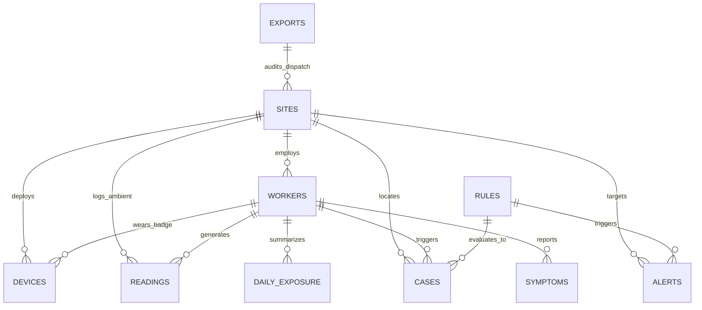

# 🗄️ Database Architecture & Data Layer Specification
## PS000109: Exposure-Triggered Worker Health Screening (Kachchh District)

---

## 1. System Overview & Architectural Invariants

The data layer is the operational backbone of the **Digital Occupational Health Monitoring System**. It bridges physical sensor telemetry (Site Nodes and Dust Badges) with clinical care delivery channels (Gujarat BOCW Dhanvantari Arogya Rath, Salt-Worker Medical Vans, and ESIC Dispensaries).

### Core Architectural Principles:
1. **Tiered Storage Lifecycle (Hot Telemetry vs. Permanent Health History)**:
   - High-frequency sensor readings (every 10s to 5min) are kept in **hot storage for 30 days** (with automated partitioning up to 90 days).
   - Nightly aggregations roll up raw data into `daily_exposure`, creating a permanent, compact longitudinal occupational health record.
   - **Storage Savings**: Reduces database volume by **99.7%** (from ~40 MB/worker/month to < 120 KB/worker/month).
2. **Privacy-by-Design (DPDP Act 2023 Compliance)**:
   - Worker consent is logged per individual (`consent_given`, `consent_version`, `consent_timestamp`).
   - District authorities (DDO Kachchh, Chief District Health Officer) **can only query anonymized views** (`district_taluka_heat_summary`, `district_anonymous_risk_summary`).
   - Personally Identifiable Information (PII) like names and 12-digit e-Shram UANs are masked (`XXXX-XXXX-1234`) and accessible strictly by authorized clinical personnel.
3. **National Interoperability**:
   - Integrates the 12-digit **e-Shram UAN** as the portable primary worker identifier.
   - Conforms to **ABDM (Ayushman Bharat Digital Mission)** standards via ABHA address linking, enabling records to follow workers across state lines.

---

## 2. Entity-Relationship Model (The 10 Core Tables)



### Table Schema Summary

| # | Table Name | Purpose | Primary Key | Key Relationships | Storage Tier |
|---|------------|---------|-------------|-------------------|--------------|
| 1 | `sites` | Physical work environments (Salt pans, crushers, cement, ports) | `site_id` (UUID) | Has water, toilets, shade flags | Permanent |
| 2 | `workers` | Worker identity, e-Shram UAN, ABHA ID, and consent records | `worker_id` (UUID) | Links to `sites` | Permanent |
| 3 | `devices` | Hardware inventory (ESP32 Site Nodes, Personal Badges) | `device_id` (String) | Links to `sites`, `workers` | Permanent |
| 4 | `readings` | High-frequency telemetry (WBGT, PM2.5, UV, Noise) | `reading_id` (BigSerial) | Links to `devices`, `sites` | 30-Day Hot Window |
| 5 | `daily_exposure` | Nightly summarized occupational dose & heat hours | `exposure_id` (BigSerial) | Unique(`worker_id`, `shift_date`) | Permanent |
| 6 | `rules` | Dynamic hazard thresholds and action definitions | `rule_id` (String) | Evaluated by Rules Engine | Permanent |
| 7 | `cases` | Clinical screening workflow (BOCW Rath, Salt Van, ESIC) | `case_id` (UUID) | Links to `workers`, `rules` | Permanent |
| 8 | `symptoms` | Self-reported and supervisor-logged clinical indicators | `symptom_id` (BigSerial) | Dark urine, dizziness, cough | 1-Year Sliding |
| 9 | `alerts` | Dispatched multilingual warnings (Lamps, SMS, IVR) | `alert_id` (UUID) | Links to `sites`, `workers` | Permanent Audit |
| 10| `exports` | Statutory government export logs (BOCW, ESIC, NPCCHH) | `export_id` (UUID) | SHA-256 verified extracts | Permanent Audit |

---

## 3. Storage Retention & Summarization Policy

### Storage Footprint Calculation (50 Sites, 1,000 Workers)
- **Raw Sensor Telemetry (`readings`)**:
  - 50 Ambient Site Nodes @ 1 reading / 5 minutes = 14,400 rows/day (~2.5 MB/day).
  - 1,000 Personal Badges @ 1 reading / 1 minute during 8-hour shift = 480,000 rows/day (~40 MB/day).
  - 30-Day Rolling Buffer = ~14.8 million rows (**~1.2 GB on hot NVMe disk**).
  - **Retention Maintenance**: Automatic cron job executes `DELETE FROM readings WHERE recorded_at < datetime('now', '-30 days');`.
- **Nightly Summarized Exposure (`daily_exposure`)**:
  - 1,000 rows/day = 365,000 rows/year (**~43 MB/year**).
  - Permanent longitudinal storage allows 5-year occupational disease tracking without degrading database query performance.

---

## 4. Privacy Architecture & District Aggregation

District officials (DDO Kachchh, District Health Officer) query the **`district_taluka_heat_summary`** view:
```sql
CREATE VIEW district_taluka_heat_summary AS
SELECT 
    s.taluka,
    s.site_type,
    COUNT(DISTINCT s.site_id) AS total_active_sites,
    COUNT(DISTINCT w.worker_id) AS total_monitored_workers,
    ROUND(AVG(de.avg_wbgt_c), 2) AS mean_wbgt_c,
    ROUND(MAX(de.max_wbgt_c), 2) AS peak_wbgt_c,
    ROUND(SUM(de.hours_above_wbgt_30), 1) AS total_hours_above_30c_wbgt,
    SUM(CASE WHEN de.flag_over_exposure = 1 THEN 1 ELSE 0 END) AS total_overexposed_worker_days,
    SUM(CASE WHEN s.has_potable_water = 0 THEN 1 ELSE 0 END) AS sites_lacking_drinking_water
FROM sites s
LEFT JOIN workers w ON s.site_id = w.current_site_id AND w.consent_given = 1
LEFT JOIN daily_exposure de ON w.worker_id = de.worker_id AND de.shift_date = CURRENT_DATE
GROUP BY s.taluka, s.site_type;
```
> [!IMPORTANT]
> This view guarantees **zero PII leakage**. The query returns statistical aggregates grouped by Taluka and Site Type only.

---

## 5. Query Contract Implementation

### 1. `get_workers_due_for_checkup()`
- **Trigger**: 30-day cumulative respirable silica dose > 2.5 mg/m³·hr OR > 15 hours at WBGT > 30°C with 2+ days of dark urine.
- **Output**: Ranked priority list (1-5) routed to the nearest Dhanvantari Arogya Rath or Salt-Worker Medical Van.

### 2. `get_site_risk_today(site_id)`
- **Trigger**: Live telemetry within the last 4 hours.
- **Output**: ISO 7243 WBGT status, required work-rest schedule (e.g. 50% work / 50% rest), current lamp color command, and facility violation flags.

### 3. `get_hotspots_by_job()`
- **Trigger**: Longitudinal hazard analysis across job roles.
- **Output**: Identifies high-risk job categories (e.g., crusher operators leading in respiratory symptoms; salt rakers leading in severe heat strain and dark urine).
