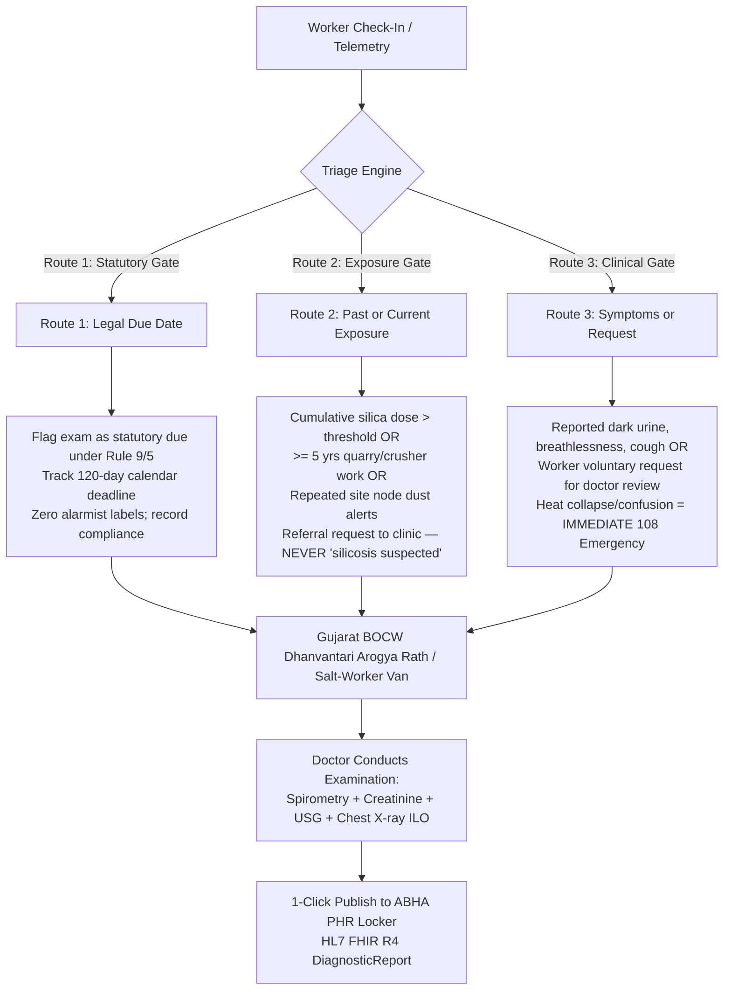

# 🏛️ WORKCHECK KACHCHH — MASTER SYSTEM & DASHBOARD ARCHITECTURE PLAN
## Problem Statement PS000109: Digital Occupational Health Monitoring for Industrial Workers
### Team TM005024 · LDRP Institute of Technology and Research, Gandhinagar
### Posted by: District Development Office (DDO), Kachchh (Healthtech)

---

## 📋 1. Statutory Alignment & The Core Problem

### The Regulatory Landscape (Gujarat & Central OSH Rules)
| Rule | Statutory Target Group | Cadence & Requirements | Form & Facility |
|---|---|---|---|
| **Gujarat OSH Rules 2025, Rule 9** | Factory & building/construction workers who have completed **age 45+** | Free annual examination **within 120 days** of the start of the calendar year | **Form 5**: Occupational history, chest X-ray, serum creatinine |
| **Central OSH Rules 2026, Rule 5** | Dock and building/construction employees who have completed **age 40+** | Annual periodic examination | **Form-VIII**; ESIC facilities may be utilized |

### The Critical Gap
- **Dust and heat harm workers by cumulative exposure, not by chronological age.**
- A 25-year-old stone quarry driller or salt-pan raker with 7 years of intense silica or solar exposure has zero statutory right to an employer-funded annual examination.
- **Self-employed salt-pan workers (Agariyas)** in the Little Rann of Kutch have no formal employer to bear the examination duty.
- **Factory inspection coverage is thin**: National data shows inspection reaches only ~15% of all factories and ~26% of registered hazardous units.
- **Fear of job loss**: Workers conceal early symptoms (dark urine, dry cough, dizziness) because identifying as sick risks immediate termination or blacklisting.

---

## 🎯 2. The 3 Clinician-Approved Routing Triggers

Our system replaces arbitrary age-based gates with an objective, clinician-reviewed 3-route triage engine:

---

## 💻 3. The 4 Dashboard Personas & Web Interfaces

### 📱 View 1: Worker QR Health Pass & Portable ABHA Locker (`/worker`)
- **Target Audience**: Informal Agariyas (salt rakers), quarry workers, port loaders.
- **Languages**: **ગુજરાતી (Gujarati)**, **हिंदी (Hindi)**, **English** with high-contrast outdoor UI.
- **Core Features**:
  1. **Visual Health Badge**: Green (Screened & Current), Amber (Screening Advised), Red (Clinical Visit Scheduled).
  2. **Linked Identifiers**: Masked 12-digit **e-Shram UAN** (`1000-XXXX-4091`) + **ABHA ID** (`91-2041-8890-1234`) + ABHA Address (`ramesh.ahir@abdm`).
  3. **Personal Exposure Thermometer**: Displays cumulative dust dose ($mg/m^3 \cdot hr$) and hours worked above WBGT 30°C.
  4. **1-Touch Visual Symptom Logger**:
     - Dark urine (કાળો પેશાબ — dehydration / kidney strain)
     - Dizziness / fainting (ચક્કર — heat exhaustion)
     - Persistent cough (ઉધરસ — silica dust irritation)
     - Eye burning from salt glare (મીઠાના તડકાથી આંખની બળતરા)
  5. **Portable Verified Health Certificate**: Printable / downloadable PDF certificate with verified QR code, accepted across employers without revealing private diagnostic details to contractors.

---

### 🏭 View 2: Worksite Live Watch & ISO 7243 Lamp Supervisor (`/site`)
- **Target Audience**: Worksite supervisors, salt-pan managers, contractor safety officers.
- **Core Features**:
  1. **Real-Time Environmental Gauges**: Ambient Temperature ($T_a$), Relative Humidity ($RH\%$), 150mm Copper Globe Temp ($T_g$), Outdoor WBGT ($WBGT_{out} = 0.7 T_{nwb} + 0.2 T_g + 0.1 T_a$), and Optical Dust $PM_{2.5} / PM_{10}$.
  2. **Giant Color Status Lamp**:
     - 🟢 **GREEN** ($WBGT < 28.0^\circ\text{C}$): Continuous work, routine hydration.
     - 🟡 **YELLOW** ($28.0^\circ\text{C} \le WBGT < 29.5^\circ\text{C}$): 45 min work / 15 min shaded rest.
     - 🟠 **ORANGE** ($29.5^\circ\text{C} \le WBGT < 31.0^\circ\text{C}$): 30 min work / 30 min shaded rest.
     - 🔴 **RED** ($WBGT \ge 31.0^\circ\text{C}$): 15 min work / 45 min shaded rest; halt heavy unshaded labor.
  3. **Active Work-Rest Countdown Clock**: Dynamic timer enforcing mandatory shaded recovery intervals.
  4. **Cool-Shift Timing Optimizer**: Demonstrates the impact of shifting a 9-hour shift from **9am–6pm to 6am–3pm**, eliminating ~20% of dangerous heat hours (~358 hours/year in Kandla/Mundra).
  5. **Daily Statutory Compliance Checklist**:
     - [ ] Potable chilled drinking water tank filled?
     - [ ] ORS electrolyte packets distributed?
     - [ ] Shaded canopy shelter available within 100 meters?
     - [ ] Sanitation latrines accessible?

---

### 🚑 View 3: Mobile Medical Van Clinical Station & ABHA Publisher (`/van`)
- **Target Audience**: Screening doctors and nurses aboard the **Gujarat BOCW Dhanvantari Arogya Rath** and **Salt-Worker Medical Vans**.
- **Core Features**:
  1. **Prioritized Due List**: Ranks workers in queue by combined risk score ($5/5$ critical priority at top).
  2. **Filter by Route**: Filter by Route 1 (Rule 9/5 Due Date), Route 2 (Cumulative Dust Exposure), or Route 3 (Symptom Trigger).
  3. **Rapid Clinical Entry Form**:
     - **Spirometry**: $FEV_1$ (liters), $FVC$ (liters), auto-calculated $FEV_1/FVC$ ratio. Ratio $< 0.70$ indicates obstructive impairment.
     - **Renal Biomarkers**: Serum Creatinine ($mg/dL$, normal $0.7 - 1.2$), Urine Specific Gravity ($USG \ge 1.020$ indicates dehydration).
     - **Chest Radiography**: Standard ILO Pneumoconiosis Grading (`0/-`, `0/0`, `1/0`, `1/1`, `2/1`, `2/2`, `3/3`, `PMF`).
     - **Gujarat Form 5 Occupational History**: Years in dust, prior quarry work, clinical notes, and Medical Council Registration Number.
  4. **1-Click "Publish to ABHA ID"**:
     - Executes `services/abdm_publisher.py`.
     - Generates compliant **HL7 FHIR R4 DiagnosticReport** Bundle.
     - Calculates cryptographic SHA-256 CareContext signature.
     - Deposits bundle into worker's ABHA PHR Locker (`worker@abdm`).
     - Triggers automated bilingual SMS notification (Gujarati & Hindi).

---

### 🏛️ View 4: District Administration (DDO Kachchh) Macro Heatmap (`/district`)
- **Target Audience**: District Development Officer (DDO Kachchh), Chief District Health Officer (CDHO), Labour Commissioner.
- **Privacy Standard**: **100% DPDP Act 2023 Compliant** (Strictly anonymized aggregates, zero individual medical records, zero names or e-Shram UANs exposed).
- **Core Features**:
  1. **Taluka Hazard Heatmap**: Geographic overview of Mundra, Kandla/Gandhidham, Bhuj, Anjar, Abdasa, and Little Rann of Kutch:
     - Hours above WBGT 30°C.
     - Micro-particulate dust violation counts.
     - Infrastructure deficit clusters (sites missing water or shade).
  2. **Mobile Van Fleet Tracker**: Real-time deployment status of Gujarat BOCW Dhanvantari Arogya Rath units and Salt-Worker vans.
  3. **1-Click Statutory Exports**:
     - Gujarat BOCW Welfare Board Due List (`.csv`)
     - Industries Commissionerate Salt Pan Van Priority Roster (`.csv`)
     - NPCCHH Weekly Heat Illness Surveillance (`.json`)
     - ESIC Referral Batch (`.csv`)

---

## 🛠️ 4. Low-Cost Hardware Node Architecture (₹2,000–₹2,500)

| Component | Function | Technical Specification | Approx. Cost |
|---|---|---|---|
| **ESP32 DevKit V1** | Microcontroller & Comms | 240MHz Dual Core, Wi-Fi 802.11 b/g/n, BLE 4.2 | ₹400 |
| **BME280** | Air Temp & Humidity | $\pm 0.5^\circ\text{C}$ accuracy, $0-100\% RH$ | ₹300 |
| **Black Globe Probe** | Radiant Solar Heat | NTC 10k thermistor inside 150mm matte-black copper globe | ₹150 |
| **Plantower PMS5003** | Dust PM2.5 / PM10 | Laser scattering, $0.3 - 10 \mu m$ particle range | ₹950 |
| **Battery & Enclosure** | Field Deployment | 18650 Li-Ion + IP65 weatherproof junction box | ₹400 |
| **Total BOM Cost** | **Complete Site Node** | **Plug-and-play solar / battery microclimate station** | **₹2,200** |

---

## 🔒 5. Safeguards & Clinical Boundaries

1. **Software Does Not Diagnose**: The system flags referral requests based on objective exposure thresholds. It never outputs a definitive diagnosis or uses alarmist terms like "Silicosis Suspected" on worker-facing screens.
2. **Worker Control & Anti-Retaliation**: Employers cannot view individual health or symptom data. Workers hold their own record via ABHA. Form 5 statutory clearance certificates remain under the examining physician's authority.
3. **Emergency Protocol**: Any worker presenting with heat collapse, confusion, or severe delirium immediately triggers the **108 GVK-EMRI cooling and emergency transfer protocol**.
